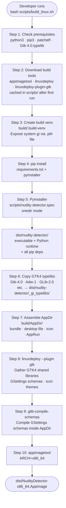

# 05 — Build Pipeline

The full packaging pipeline from source to distributable AppImage,
covering both local developer builds and the CI release workflow.

## Local build (scripts/build_linux.sh)



## CI release workflow (.github/workflows/release.yml)

```mermaid
flowchart TD
    A([Push to main\nor manual workflow_dispatch]) --> B[Validation jobs\nlint · pytest · pip-audit\ntest needs lint; audit runs in parallel]
    B --> C{Validation gate\nall jobs passed?}
    C -- No --> D([Workflow fails\nno build or release])
    C -- Yes --> E[Build AppImage\nUbuntu runner\nAPPIMAGE_EXTRACT_AND_RUN=1]
    E --> F{Build succeeded?}
    F -- No --> D
    F -- Yes --> G[Verify AppImage and bundle\nupload appimage-build artifact]
    G --> H[Download build artifact\ncheck whether HEAD is already tagged]
    H --> I{HEAD already tagged?}
    I -- Yes --> J([Skip release])
    I -- No --> K[Compute UTC CalVer tag\nYYYY.MM.DD or YYYY.MM.DD.N\ncheck uniqueness on origin]
    K --> L[Create and push generated tag]
    L --> M[Rename asset to\nNudityDetector-<generated-tag>-x86_64.AppImage]
    M --> N[softprops/action-gh-release@v2\nCreate GitHub Release\nattach AppImage]
    N --> O([GitHub Release published])

    style D fill:#7f1d1d,color:#fca5a5
    style O fill:#14532d,color:#86efac
```

The workflow validates and builds the selected commit before generating and
pushing its UTC CalVer tag. Do not push a tag to trigger a release.

## What is bundled vs host-required

| Component | Bundled in AppImage | Notes |
|-----------|--------------------|----|
| Python 3.12 runtime | Yes | PyInstaller embeds interpreter |
| pip dependencies | Yes | Collected by PyInstaller |
| GTK4 shared libraries | Best-effort | `linuxdeploy-plugin-gtk` collects from build host |
| GTK4 GI typelibs | Yes | Explicitly copied by `build_linux.sh` step 6 |
| GSettings schemas + themes | Yes | Collected by `linuxdeploy-plugin-gtk` |
| NudeNet model weights | No | Downloaded on first run — requires internet access |
| libadwaita | Best-effort | Must be installed on build host |
